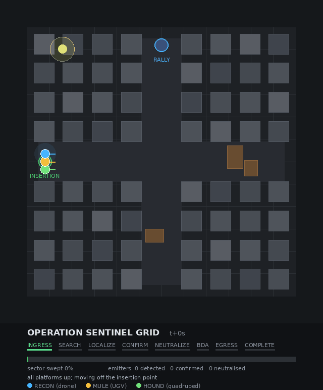
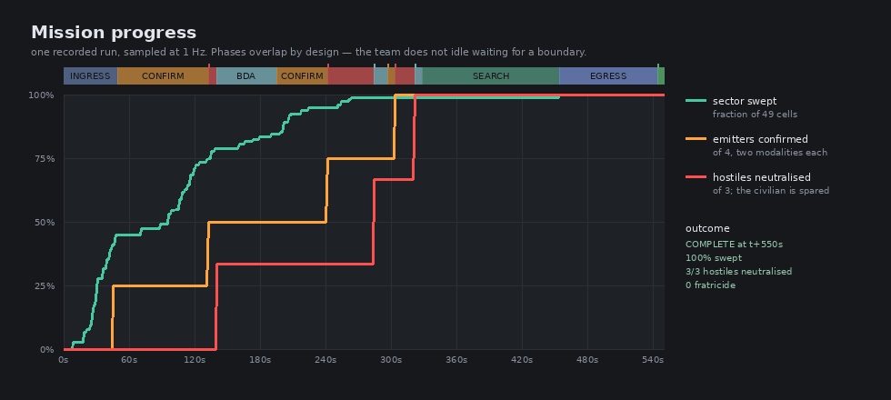
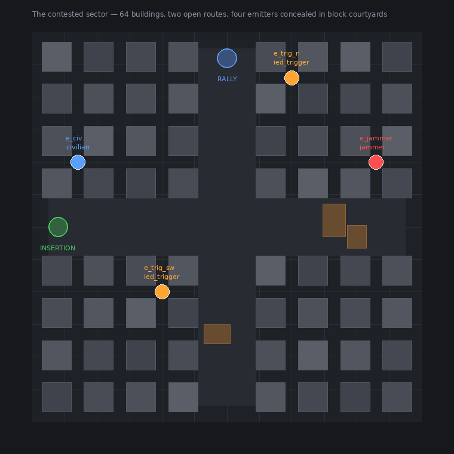
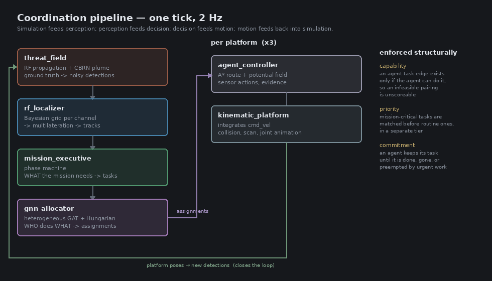

# GNN-Based Swarm Robotics — Operation Sentinel Grid

A **heterogeneous three-robot swarm** that sweeps a contested urban sector,
localises hidden radio emitters, decides which are hostile, and neutralises
them — without touching the one it is forbidden to touch.

Task allocation is driven by a **heterogeneous Graph Attention Network**, whose
output is projected onto a conflict-free assignment by the **Hungarian
algorithm**. Built on **ROS 2 Humble**, visualised in **RViz**.



*A complete recorded mission. Blue is the quadrotor, amber the UGV, green the
quadruped. Rings are emitter-position uncertainty; ⊗ marks a neutralised
emitter; the blue track is the civilian transmitter, correctly spared.*

---

## The result

Every run ends with a report scored against ground truth:

```
OPERATION SENTINEL GRID — MISSION REPORT
========================================================================
  outcome        COMPLETE after 550 s
  sector swept   49/49 cells (100%)
  emitters:
    e_jammer     jammer       (  46.0,  20.0)  fix error  0.1 m  NEUTRALIZED  class JAMMER       correct
    e_trig_sw    ied_trigger  ( -20.0, -20.0)  fix error  0.1 m  NEUTRALIZED  class IED_TRIGGER  correct
    e_trig_n     ied_trigger  (  20.0,  46.0)  fix error  1.3 m  NEUTRALIZED  class IED_TRIGGER  correct
    e_civ        civilian     ( -46.0,  20.0)  fix error  4.8 m  CONFIRMED    class civilian     correct
  engagement:
    neutralised correctly  3: ['e_jammer', 'e_trig_sw', 'e_trig_n']
    hostiles left active   0: -
    fratricide             0  (civilian transmitter respected)
========================================================================
```

| | |
|---|---|
| sector swept | **49 / 49 cells** |
| emitters found | **4 / 4**, from a cold start with no prior on position or power |
| fix accuracy | **0.1 – 4.8 m** |
| classification | **4 / 4 correct**, including jammer vs. civilian |
| hostiles neutralised | **3 / 3** |
| fratricide | **0** |



---

## Quick start

```bash
git clone https://github.com/PioneerAIRobots/GNN-based-Swarm-robotics.git
cd GNN-based-Swarm-robotics/ros2_ws
source /opt/ros/humble/setup.bash
colcon build --cmake-args -DCMAKE_BUILD_TYPE=Release
source install/setup.bash
ros2 launch swarm_bringup mission.launch.py
```

RViz opens and the mission runs unattended for 7–9 minutes, then prints the
report. Requires ROS 2 Humble and `torch` (CPU is fine).

| command | what it does |
|---|---|
| `ros2 launch swarm_bringup mission.launch.py` | full mission with RViz |
| `... mission.launch.py rviz:=false` | logs only, no GUI |
| `... mission.launch.py use_gnn:=false` | analytic cost oracle instead of the network |
| `python3 src/swarm_gnn/tools/selfcheck.py` | 11-check regression suite, no ROS needed |
| `python3 src/swarm_gnn/tools/navigation_check.py` | can each platform reach where it is sent? |
| `ros2 launch swarm_description view_robot.launch.py robot:=quadruped` | inspect one URDF with joint sliders |

---

## The scenario



A 120 m × 120 m built-up sector, 64 buildings in 16 blocks, with an 18 m main
route east–west and a cross street north–south. Four emitters hide in the block
courtyards:

| emitter | what it is | required outcome |
|---|---|---|
| `e_jammer` | GNSS/comms jammer, 30 dBm, denies comms within 38 m | **neutralise** |
| `e_trig_sw` | command trigger for a buried charge, 14 dBm, 55% duty cycle | **neutralise** |
| `e_trig_n` | command trigger, 16 dBm, 65% duty cycle | **neutralise** |
| `e_civ` | licensed civilian transmitter, 24 dBm | **leave alone** |

The scenario is built so that no single platform can do the job:

- **You cannot see a radio.** Emitters are only detectable by direction
  finding, and a bearing from one place gives a line, not a position. A 1.4 m
  observer baseline produces a **60 m** position error.
- **The triggers are intermittent**, so one pass over a cell can miss them.
- **Rubble blocks the UGV**; the 4 m alleys deny the drone useful look angles;
  the courtyards need something that can walk in.
- **The jammer and the civilian are indistinguishable on radio.** Both are
  loud, both read cold on CBRN. The only discriminator is that the jammer
  degrades the comms of anything near it — somebody has to go and measure it.

---

## The three platforms

All three are complete URDF models with real inertia tensors, joint limits,
collision geometry and the mission sensor fit.

| | **RECON** (quadrotor) | **MULE** (4×4 skid-steer UGV) | **HOUND** (quadruped) |
|---|---|---|---|
| links / joints | 31 / 6 | 19 / 4 | 29 / **12** |
| speed | 8.0 m/s | 3.2 m/s | 1.5 m/s |
| key sensor | LWIR thermal, 24° FOV | DF array, **300 mm baseline** (σ = 0.07 rad) | **CBRN sampler**, 2.5 m standoff |
| also carries | EO camera on a 2-axis gimbal, AGL scan, GNSS, IMU, 3-element DF | 2D + 3D LiDAR, RGB, GNSS, IMU, marker dispenser (×4) | head camera, 2D LiDAR, GNSS, IMU, 4-element DF |
| unique capability | altitude, thermal, comms relay | **the only platform that can emplace a marker** | **the only platform that can sample CBRN** |

Each robot has something the others do not, and the mission cannot be completed
without all three.

---

## How it works



The design splits cleanly: the **executive** decides *what the mission needs*,
the **GNN** decides *who should do it*, and the **solver** enforces the
combinatorics. They are coupled only through topics, so the allocation policy
can be retrained without touching mission logic.

### Phases

| phase | what happens |
|---|---|
| `INGRESS` | all three move off the insertion point onto the main route |
| `SEARCH` | 49 cells partitioned by capacity-constrained Lloyd descent |
| `LOCALIZE` | a contact exists but range is unresolved → spend **triangulation baselines**, not more samples |
| `CONFIRM` | two *independent* sensor modalities required |
| `NEUTRALIZE` | the UGV emplaces a jammer-marker on a confirmed hostile |
| `BDA` | the drone verifies the emitter went silent |
| `EGRESS` | recover to the rally point once **every** cell is swept |

Phases overlap by design — waiting for clean boundaries would idle the two
platforms not involved in the current step.

### The rules-of-engagement chain

This is the crux of the scenario. Robots report what they **observed**, never
what they concluded; the class is derived from the pooled evidence:

| evidence | conclusion |
|---|---|
| `cbrn_pos` | **IED trigger** — engageable |
| `jam_detected`, without `cbrn_pos` | **jammer** — engageable |
| `thermal_hot` + `cbrn_neg` + `no_jam` | **civilian** — no-strike |
| anything less | unknown, keep looking |

> An earlier version had each robot assert a class from its own sensor, so a
> clean CBRN sample reported "civilian" — and the jammer, having no chemical
> signature, was permanently classified no-strike and could never be engaged.
> **That single line was why the mission produced no results at all.**

---

## The algorithms

### Heterogeneous graph attention network — 752,259 parameters

Allocation in a heterogeneous team is not a per-agent decision. Whether the dog
should take a CBRN sample depends on where the UGV is, whether the drone is the
only comms bridge, and how the *other* tasks cluster around that sample. That
is a relational problem over a graph whose size changes every tick.

```
agent ──comms──→ agent      edge exists only within radio range
agent ───bid───→ task       edge exists only if the agent is capability-feasible
task ──cluster─→ task       nearest neighbours within 22 m
```

Per layer, per relation, an independent edge-conditioned **GATv2** operator.
Agent and task nodes have separate encoders and separate per-type weights at
every layer — genuinely heterogeneous, not one GAT over a relabelled graph.
Three heads: per-edge utility, per-agent relay desirability, and a caution
scalar feeding the local controller's speed envelope.

**Hard constraints live in the topology, not in a penalty.** An infeasible
pairing has no edge, therefore no score, and the solver can never pick it.
Verified: **0 infeasible picks** across every training and validation decision.

> `torch_geometric` is **not** a dependency. Message passing is written against
> per-edge index tensors with segment-softmax and `index_add_`, which is what
> PyG's `GATConv` does internally.

### Hungarian — in two tiers, with commitment

Verified optimal against brute-force enumeration on 200 random matrices on
every test run. A single global solve turned out to be the wrong objective in
two distinct ways, both of which were real failures:

- **Across priority classes.** Hungarian maximises the *total*, so three cheap
  nearby search cells out-score one distant thermal confirm. Measured: a
  confirm task sat unassigned for 165 s while the drone tidied up coverage.
  Urgent work is now matched first, in its own tier.
- **Across time.** Re-auctioning at 2 Hz re-tasks constantly. Measured: the
  drone retasked **188 times in 270 s**, and because a cell is only marked
  swept once its assigned agent reaches it, nothing was ever swept. Raising the
  hysteresis margin does not help — the flip magnitude scales with the same
  utilities the margin is measured in. **Commitment** does.

### Global A* + local potential field

A reactive controller cannot leave a concave trap, and a grid of 64 buildings
is nothing but concave traps. A* over a per-platform inflated occupancy grid
decides *which way round*; the potential field tracks the next waypoint and
handles what the map does not contain.

> **Courtyard entry was impossible for both ground platforms.** The repulsive
> influence radius (3.0 m) exceeds the half-width of a 4 m alley, so flanking
> buildings pushed the robot back out of the mouth. Both bounced at ~13 m from
> a courtyard goal indefinitely while open-route travel worked fine. The fix
> follows from the architecture: A* has already certified the route is free, so
> the component of repulsion *opposing* travel is projected out. **4 of 7
> journeys were impossible; now 7/7 complete.**

### Recursive Bayesian localisation + Gauss-Newton multilateration

Two estimators in series, because neither works alone: a log-probability
occupancy grid (order-free, multi-modal, no initial guess needed), then
iteratively-reweighted Gauss-Newton with Huber weighting once it concentrates.

Five failure modes were found and are closed in code, each with a regression
check:

| failure | symptom | fix |
|---|---|---|
| **GDOP** | 1.4 m baseline → 60 m error reported with 2.9 m sigma | refuse such cut sets outright |
| **unknown tx power** | confident 0.8 m fix in the sector corner | marginalise power as a nuisance parameter (σ = 9 dB) |
| **domain truncation** | tracks pinned to the grid boundary | discard the boundary band |
| **ghost under the robot** | the observer's own position became the most likely emitter site | clamp the *bearing* term only, not the total |
| **emitter mixing** | up to **13 tracks for 4 emitters** | one belief grid **per frequency channel** |

### Capacity-constrained Lloyd coverage

Plain Lloyd on time metrics is degenerate here: the 8 m/s drone absorbed **92
of 100 cells** and the ground platforms idled. A per-agent bias — a Lagrange
multiplier on the load constraint — drives each share toward a `speed^0.5`
target, giving **45% / 30% / 25%** and comparable sweep times.

---

## Training

The allocator is trained by imitating an optimal Hungarian oracle over a
hand-written analytic cost:

| | untrained | trained |
|---|---|---|
| top-1 agreement with the optimal matching | 0.136 | **0.77** |
| infeasible picks | 0 | **0** |

```bash
python3 -m training.train_allocator --epochs 30 --out checkpoints/allocator.pt
```

What the network adds over the cost function is *relational* context — who else
is nearby, whether this agent is the only comms bridge, how tasks cluster —
which a per-pair cost cannot express. It does **not** discover a better policy
than the oracle's; that would need reward from full mission rollouts.

### Timing

The coordination tick budget is 500 ms at 2 Hz:

| stage | time |
|---|---|
| build graph | 0.58 ms |
| GNN forward | 6.73 ms |
| Hungarian solve | 0.20 ms |
| **total algorithm** | **7.7 ms** |
| end-to-end, live | 6 ms mean, 89 ms max |

---

## Repository layout

```
ros2_ws/src/
├── swarm_interfaces/     10 messages: AgentState, TaskSpec, Assignment,
│                         ThreatDetection/Estimate, GraphDebug, MissionStatus
├── swarm_description/    full URDFs for all three platforms + sensor macros
├── swarm_gnn/
│   ├── swarm_gnn/model/  sector, planner, het_gat, graph_builder, assignment,
│   │                     rf_localizer, coverage, navigation   ← NO ROS IMPORTS
│   ├── swarm_gnn/nodes/  allocator, executive, localizer, threat_field,
│   │                     agent_controller, kinematic_platform, viz
│   ├── training/         scenario generation + allocator training
│   └── tools/            selfcheck, navigation_check, record/render media
└── swarm_bringup/        mission.launch.py + the RViz display
```

`swarm_gnn/model/` imports no ROS — the network, solver, estimator and planner
all train, profile and unit-test without a ROS installation.

---

## There is no physics engine

Deliberate, and worth stating plainly. The subject here is swarm coordination:
who goes where, on what evidence, under what constraints. None of that is
decided by contact dynamics. Each platform integrates its own commanded
velocity against the known sector geometry.

**Modelled:** real velocity envelopes, height-aware building collision with a
slide-along-wall response, a synthetic 360° LaserScan ray-cast against the same
geometry, and per-platform joint animation driven by the same velocity command
(so the quadruped's gait, the UGV's wheels and the drone's rotors always match
what the coordination layer asked for).

**Not modelled:** contact forces, slip, rotor aerodynamics, dynamic balance.

---

## The most expensive bug was in the map

Worth recording, because the symptom pointed hard at the wrong layer. The UGV
would not drive: commanded 1.5 m/s it travelled 0.15 m in 8 s, yawed without
translating, and once slid 34 m out of the sector unprovoked. That reads
unmistakably as a drive or contact problem, and it was chased as one — through
friction parameters, ride height, and three different drive plugins.

The actual cause: **the insertion point was inside a building footprint.** The
robot spawned intersecting a wall, facing 45° into it. It could rotate but not
translate. Driving the *other* way covered 6.99 m cleanly, which is what
finally exposed it.

The same check then found that **all four emitters were buried inside building
volumes**, where no thermal confirm and no CBRN sample is physically possible —
and that the "clear main route" was not clear.

All three are now impossible: the layout is derived parametrically in
`model/sector.py`, the single source of truth for the planner, the platforms,
the threat field and the visualiser, and `sector.validate()` refuses to run an
incoherent one.

---

## Honest limitations

- **Imitation, not RL.** The policy approximates a known-good analytic cost
  relationally; it does not discover a better policy than the oracle's.
- **Fusion is centralised.** The grid update is additive in log space, so
  per-robot copies over gossiped detections converge to the same posterior, and
  the topic layout already supports it — but the gossip protocol is not
  implemented.
- **RF propagation is a log-distance model** with shadowing, slab occlusion and
  reflected-path bias, not a ray-traced channel. The simulated sensor and the
  estimator share the propagation function, so the estimator is untested
  against a structurally different channel.
- **~8 minutes of wall time**, because the platforms move at their real speeds
  and all 49 cells are genuinely swept. No time acceleration.
- **The drone finishes near flat** (8–16% battery). There is no
  return-to-base-on-low-battery rule; energy is reflected in the allocator's
  cost model but not as a hard constraint.
- **Spurious candidates still appear** late in a run from detections left in
  memory after an emitter goes silent. Four guards keep them from costing the
  team anything, and residual contacts are reported rather than pursued.

---

## License

Apache-2.0
